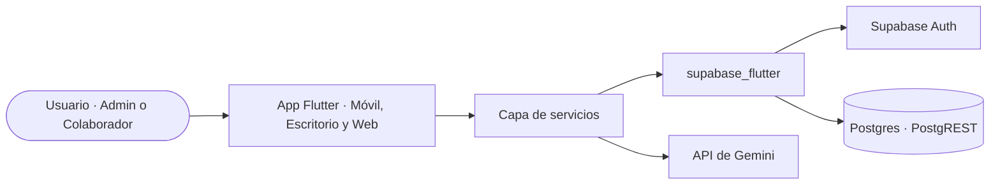

# Architectural spine · Recomendador de Eventos para Peewah

## Resumen

Aplicación para la recomendación y configuración ágil de eventos recurrentes en Peewah.
Se ejecuta en plataformas móvil, escritorio y web construida sobre el framework Flutter.
Utiliza Supabase (Auth y Postgres vía PostgREST) como backend sin servidor propio y la API de Gemini para la generación estructurada de recomendaciones operativas.

## Stack

- **Framework y lenguaje:** Flutter 3.x y Dart 3.x.
- **Cliente backend:** `supabase_flutter`.
- **Plataformas de ejecución:** Móvil, escritorio y web (interfaz adaptable).

## Diagrama

## Qué cubre cada servicio

- **Supabase Auth:** Inicio y cierre de sesión de administradores y colaboradores; asignación de identidad única (`uuid`).
- **Supabase Postgres (PostgREST):** Persistencia relacional de organizaciones, usuarios, categorías, eventos, campos de formulario, cronogramas, tareas, inscripciones, respuestas, recomendaciones, bloques y recordatorios, cargando inicialmente el dataset sintético como datos semilla.
- **API de Gemini:** Inferencia operativa a partir de los datos del nuevo evento y del historial de ediciones previas, retornando bloques de formulario, cronograma, tareas y tiempos en formato JSON estructurado.

## Invariantes

### AD-01 · Sin backend propio
- **Regla:** La aplicación Flutter se comunica directamente con Supabase (a través de `supabase_flutter`) y con la API de Gemini mediante su capa de servicios, sin desplegar un servidor backend intermedio.
- **Evita:** Desplegar, configurar y costear infraestructura de servidores adicionales innecesaria para el MVP.

### AD-02 · Capa de servicios obligatoria
- **Regla:** Solo las clases de la capa de servicios interactúan con Supabase y con la API externa; las pantallas y widgets únicamente consumen dichos servicios.
- **Evita:** Consultas duplicadas, lógica de red dispersa en la interfaz y acoplamiento directo de las pantallas con la infraestructura.

### AD-03 · Identidad referenciada a Auth
- **Regla:** Todo registro perteneciente a un usuario en la base de datos almacena el `uuid` generado por Supabase Auth.
- **Evita:** Duplicidad de identidades o desincronización entre credenciales de acceso y perfiles de usuario.

### AD-04 · Credenciales fuera del código
- **Regla:** La URL del proyecto, la publishable key de Supabase y la clave de la API de Gemini se leen desde variables de entorno o archivos de configuración local, nunca fijas en el código fuente.
- **Evita:** Exponer credenciales sensibles en el repositorio y la necesidad de modificar código para cambiar de entorno o llaves.

### AD-05 · Contrato estricto en JSON para recomendaciones
- **Regla:** Toda interacción con la API de Gemini debe solicitar y validar respuestas estrictamente en formato JSON que contengan los bloques `form`, `schedule`, `tasks` y `timing`.
- **Evita:** Respuestas en texto libre no estructurado que bloqueen el procesamiento o fallen al renderizar en la interfaz.

### AD-06 · Sin almacenamiento binario en base de datos
- **Regla:** La base de datos relacional almacena únicamente datos estructurados y texto; no se persisten archivos binarios ni imágenes en Postgres.
- **Evita:** La saturación de espacio y la degradación del rendimiento de Postgres.

### AD-07 · La recomendación se guarda antes de mostrarse
- **Regla:** Cada bloque que devuelve Gemini se guarda como bloque de recomendación con decisión pendiente, y la decisión del administrador lo actualiza.
- **Evita:** Perder recomendaciones y no poder medir aceptación (RNF-06).

### AD-08 · El historial sale de la base de datos
- **Regla:** El contexto que se envía a Gemini se arma con los eventos guardados en las tablas, nunca con datos escritos en el código.
- **Evita:** Amarrar el dataset sintético al código y no poder cambiarlo por datos reales.

## Diferido

- **Envío automático de correos (RF-14):** Despacho automatizado de recordatorios a los inscritos; en el MVP solo se sugieren y almacenan las fechas programadas.
- **Supabase Storage:** No se utiliza almacenamiento de archivos, imágenes o afiches pesados en el MVP.
- **Supabase Edge Functions, Realtime y RLS:** Funciones serverless, sincronización en tiempo real por WebSockets y políticas avanzadas por fila diferidas para mantener la arquitectura ligera.
- **Custodia de la llave de Gemini en backend:** En el MVP la API key de Gemini viaja dentro de la app; mover esta invocación y la custodia de la clave a una Edge Function cuando se use en producción.
- **Modelos estadísticos avanzados:** Algoritmos nativos en backend (k-NN, forecasting de series temporales, descomposición estacional) aplazados para cuando la plataforma disponga de un volumen representativo de datos reales.
- **Paquetes externos adicionales:** Se difiere la integración de librerías adicionales a `supabase_flutter` hasta acordar su necesidad con el equipo.

## Historial

- 0.1.0 · 2026-11-06 · Primera versión.
