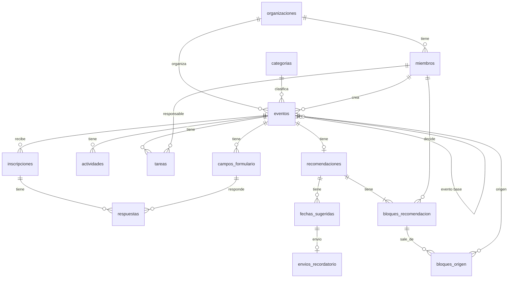

# Modelo de datos · Recomendador de Eventos para Peewah

Versión 0.1.0 · 2026-11-06 · Basado en requisitos 0.2.0, architectural_spine 0.2.0 y las specs F-01 a F-08.

## organizaciones

- id (PK)
- nombre

## miembros

- id (PK)
- organizacion_id (FK a organizaciones)
- usuario_id (uuid de Auth, AD-03)
- nombre
- rol (administrador o colaborador)

## categorias

- id (PK)
- nombre (congreso, feria, seminario…)

## eventos

- id (PK)
- organizacion_id (FK a organizaciones; vacío si es la configuración típica de una categoría)
- categoria_id (FK a categorias)
- evento_base_id (FK a eventos; el evento usado como base, si hubo)
- nombre
- modalidad (presencial, virtual o híbrida)
- tamano_estimado
- fecha
- estado (en configuración o configurado; F-06)
- es_tipico (sí si es la configuración típica de su categoría)
- creado_por (FK a miembros)
- creado_en

## campos_formulario

- id (PK)
- evento_id (FK a eventos)
- nombre
- obligatorio
- orden

## actividades

- id (PK)
- evento_id (FK a eventos)
- nombre
- dia_relativo (días respecto a la fecha del evento)
- hora

## tareas

- id (PK)
- evento_id (FK a eventos)
- nombre
- responsable_id (FK a miembros)
- dias_antes_vence

## inscripciones

- id (PK)
- evento_id (FK a eventos)
- nombre_asistente
- correo
- fecha_inscripcion

## respuestas

- id (PK)
- inscripcion_id (FK a inscripciones)
- campo_id (FK a campos_formulario)
- valor

## recomendaciones

- id (PK)
- evento_id (FK a eventos)
- generada_en

## bloques_recomendacion

- id (PK)
- recomendacion_id (FK a recomendaciones)
- tipo (formulario, cronograma o tareas)
- contenido_sugerido (lo que devolvió el recomendador, AD-05)
- decision (pendiente, aceptado, editado o rechazado; AD-07)
- contenido_final (vacío si se aceptó o se rechazó)
- decidido_por (FK a miembros)
- decidido_en

## bloques_origen

- id (PK)
- bloque_id (FK a bloques_recomendacion)
- evento_id (FK a eventos; evento similar del que salió la sugerencia)

## fechas_sugeridas

- id (PK)
- recomendacion_id (FK a recomendaciones)
- tipo (apertura o recordatorio)
- dias_antes_sugeridos
- decision (pendiente, aceptado, editado o rechazado)
- dias_antes_finales

## envios_recordatorio

- id (PK)
- fecha_sugerida_id (FK a fechas_sugeridas; solo de tipo recordatorio)
- estado (pendiente, enviado o sin destinatarios)
- correos_enviados
- correos_fallidos
- enviado_en

## Relaciones

- Una organización tiene muchos miembros y muchos eventos.
- Una categoría tiene muchos eventos; uno de ellos puede ser su configuración típica.
- Un evento puede partir de otro evento (evento_base_id).
- Un evento tiene muchos campos de formulario, actividades, tareas e inscripciones.
- Un miembro es responsable de muchas tareas.
- Una inscripción tiene muchas respuestas, una por campo del formulario.
- Un evento tiene una recomendación; una recomendación tiene tres bloques y muchas fechas sugeridas.
- Un bloque sale de muchos eventos similares, y un evento sirve de origen a muchos bloques, a través de bloques_origen.
- Un recordatorio tiene a lo sumo un envío (F-08).

## Diagrama

## Notas

- La curva de inscripciones no se guarda: sale de contar las inscripciones por `fecha_inscripcion` frente a la `fecha` del evento.
- `contenido_sugerido` y `contenido_final` guardan el bloque como texto estructurado, tal como lo devuelve el recomendador (AD-05). Al confirmar el evento (F-06), los bloques aceptados o editados se copian a `campos_formulario`, `actividades` y `tareas`.
- El conjunto de datos de referencia (RNF-05) se carga como filas de estas mismas tablas (AD-08).
